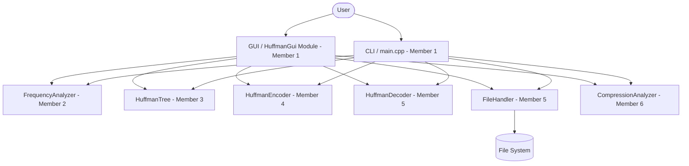

# System Architecture: Huffman Coding for Data Compression

## 1. Overview
This project is a modular, high-performance C++ implementation of the **Huffman Coding algorithm** for lossless text compression and decompression. The architecture is explicitly organized to support collaborative development across six team members, keeping modules decoupled through strict interface contracts.

The application features a modern **Desktop Graphical User Interface (GUI)** for interactive operation alongside a command-line interface (CLI) for automated pipelines.

---

## 2. Component Diagram



---

## 3. Directory Layout & Module Responsibilities

```text
Huffman-Coding-Data-Compression/
├── CMakeLists.txt              # Top-level build configuration (C++17, huffman_lib)
├── .gitignore                  # Git ignore rules for build artifacts & IDEs
├── README.md                   # Project overview, team roster & execution guide
├── docs/
│   ├── architecture.md         # System architecture blueprint & team guidelines
│   └── gui_documentation.md    # GUI design, workflow & module communication
├── examples/
│   └── input.txt               # Sample text for testing compression
├── include/
│   ├── core/
│   │   ├── FrequencyAnalyzer.h # Member 2 (Marcimoy): Character frequency analysis
│   │   ├── HuffmanNode.h       # Member 3 (Feven): Tree node structure & heap comparator
│   │   ├── HuffmanTree.h       # Member 3 (Feven): Priority queue tree builder & codes
│   │   ├── HuffmanEncoder.h    # Member 4 (Mahlet): Bitstream encoding & bit packing
│   │   ├── HuffmanDecoder.h    # Member 5 (Hermela): Tree traversal & decoding
│   │   └── CompressionAnalyzer.h # Member 6 (Bereket): Compression evaluation metrics
│   ├── file/
│   │   └── FileHandler.h       # Member 5 (Hermela): Text & binary file I/O operations
│   └── gui/
│       └── HuffmanGui.h        # Member 1 (Roberaf): Win32 desktop GUI interface
├── src/
│   ├── main.cpp                # Member 1 (Roberaf): Entry point (GUI / CLI dispatch)
│   ├── core/
│   │   ├── FrequencyAnalyzer.cpp # Member 2 (Marcimoy): Frequency counter
│   │   ├── HuffmanTree.cpp     # Member 3 (Feven): Tree construction implementation
│   │   ├── HuffmanEncoder.cpp  # Member 4 (Mahlet): Symbol encoding & bit packing
│   │   ├── HuffmanDecoder.cpp  # Member 5 (Hermela): Bitstream traversal & text reconstruction
│   │   └── CompressionAnalyzer.cpp # Member 6 (Bereket): Metrics computation & summary
│   ├── file/
│   │   └── FileHandler.cpp     # Member 5 (Hermela): File I/O implementations
│   └── gui/
│       └── HuffmanGui.cpp      # Member 1 (Roberaf): Win32 desktop GUI implementation
└── tests/
    ├── unit/
    │   └── test_huffman.cpp    # Unit tests for core algorithms & statistics
    └── integration/
        └── test_file_operations.cpp # Integration tests for file read/write
```

---

## 4. Subsystem Details & Team Work Breakdown

| Subsystem | Source / Header Files | Primary Responsibilities | Team Focus |
| :--- | :--- | :--- | :--- |
| **GUI & Coordinator** | `include/gui/HuffmanGui.h`<br>`src/gui/HuffmanGui.cpp` | Desktop UI window, input controls, codes table, bitstream & decompressed text displays, input validation, module integration. | **Member 1 (Roberaf Tamirat)** |
| **Frequency Analysis** | `include/core/FrequencyAnalyzer.h`<br>`src/core/FrequencyAnalyzer.cpp` | Frequency table computation, handling letters/numbers/spaces/punctuation, unsigned char mapping. | **Member 2 (Marcimoy Assefa)** |
| **Huffman Tree** | `include/core/HuffmanNode.h`<br>`include/core/HuffmanTree.h`<br>`src/core/HuffmanTree.cpp` | `HuffmanNode` priority queue min-heap construction, recursive tree traversal, prefix code assignment. | **Member 3 (Feven Asefa)** |
| **Encoder** | `include/core/HuffmanEncoder.h`<br>`src/core/HuffmanEncoder.cpp` | Text-to-bitstream encoding, packing bits into `uint8_t` bytes, tracking valid bits in final byte. | **Member 4 (Mahlet Eyasu)** |
| **Decoder & File I/O** | `include/core/HuffmanDecoder.h`<br>`src/core/HuffmanDecoder.cpp`<br>`include/file/FileHandler.h`<br>`src/file/FileHandler.cpp` | Tree traversal driven by bitstreams, text and binary file reading/writing, serialized compressed file storage. | **Member 5 (Hermela Tadios)** |
| **Testing & Evaluation** | `include/core/CompressionAnalyzer.h`<br>`src/core/CompressionAnalyzer.cpp`<br>`tests/` | Automated test suites, edge cases, compression ratio formula (`Original / Compressed`), space savings % formula. | **Member 6 (Bereket Yonatan)** |
| **Application Dispatch** | `src/main.cpp` | Command-line argument parsing (`--help`, `--demo`, `-c`, `-d`) & default GUI launch. | **Member 1 (Roberaf Tamirat)** |

---

## 5. Build & Execution Instructions

```bash
# 1. Build via CMake (MSVC / GCC)
cmake -B build -S .
cmake --build build

# 2. Run the compiled binary (launches Desktop GUI by default)
./build/HuffmanCoding

# 3. Run CLI demonstration & unit tests
./build/HuffmanCoding --demo
./build/tests/test_huffman
./build/tests/test_file_operations
```
