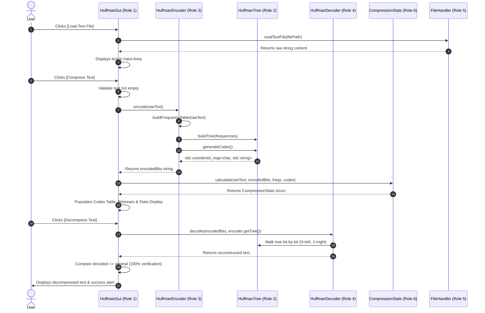

# GUI Architecture, Workflow & Integration Documentation
**Author:** Roberaf Tamirat  
**Role:** GUI Developer and Integration Coordinator (Member 1)  
**Project:** Huffman Coding for Data Compression  

---

## 1. Overview & Responsibility
As the **GUI Developer and Integration Coordinator**, Member 1 is responsible for:
1. Designing and building an intuitive, responsive desktop Graphical User Interface (GUI) that exposes all underlying compression features.
2. Connecting and integrating the modules written by other team members:
   - **Member 2 (Mahlet Eyasu):** Huffman Tree construction (`HuffmanTree`).
   - **Member 3 (Marcimoy Assefa):** Frequency table & bitstream encoding (`HuffmanEncoder`).
   - **Member 4 (Bereket Yonatan):** Tree traversal & text decoding (`HuffmanDecoder`).
   - **Member 5 (Feven Asefa):** Text and binary file I/O (`FileHandler`).
   - **Member 6 (Hermela Tadiwos):** Compression ratio and metrics analysis (`CompressionStats`).
3. Managing input validation, user notifications, and error dialogs.
4. Orchestrating team Git workflows, integration testing, and release coordination.

---

## 2. Desktop Interface Design & Wireframe

The GUI layout is organized into 5 clearly demarcated functional zones designed for clarity and ease of use:

```text
+------------------------------------------------------------------------------------------------------+
|  [Header Banner] Huffman Coding Data Compression System — Roberaf Tamirat (Role 1)                   |
+------------------------------------------------------------------------------------------------------+
|  1. Source Text Input:                                       [📂 Load Text File...]  [ Clear All ]  |
|  +------------------------------------------------------------------------------------------------+  |
|  | Enter or paste uncompressed source text here...                                                |  |
|  +------------------------------------------------------------------------------------------------+  |
|                                                                                                      |
|  [ 🗜️ Compress Text ]     [ 🔓 Decompress Text ]                                                      |
|                                                                                                      |
|  +--------------------------------------------+  +------------------------------------------------+  |
|  | 2. Generated Huffman Codes Table:          |  | 3. Encoded Bitstream Output (0s & 1s):         |  |
|  | +-------+-------+------+--------------+----+  | +--------------------------------------------+ |  |
|  | |Symbol | ASCII | Freq | Huffman Code |Bits|  | | 0110100111000101011010001...                 | |  |
|  | +-------+-------+------+--------------+----+  | +--------------------------------------------+ |  |
|  | | 'e'   |  101  |  16  | 00           |  2 |  |                                                |  |
|  | | ' '   |   32  |   4  | 1101         |  4 |  | 4. Reconstructed Decompressed Text:           |  |
|  | | 'h'   |  104  |   1  | 11110        |  5 |  | +--------------------------------------------+ |  |
|  | +-------+-------+------+--------------+----+  | | huffman coding for data compression        | |  |
|  |                                            |  | +--------------------------------------------+ |  |
|  +--------------------------------------------+  +------------------------------------------------+  |
|                                                                                                      |
|  5. Compression Statistics & Metrics (Member 6 Deliverables):                                        |
|  +------------------------------------------------------------------------------------------------+  |
|  | Original: 35 bytes (280 bits) | Compressed: 18 bytes (141 bits) | Space Saved: 48.6%           |  |
|  | Compression Ratio: 51.4%     | Avg Code Length: 4.03 bits/char | Shannon Entropy: 3.82 bits     |  |
|  +------------------------------------------------------------------------------------------------+  |
|  [Status Bar] Ready | Lossless verification: 100% Match                                              |
+------------------------------------------------------------------------------------------------------+
```

---

## 3. Interface Components Breakdown

| Component | Control Type | Description |
|---|---|---|
| **Source Text Input** | Multiline Text / Edit Control (`IDC_EDIT_INPUT`) | Accepts direct user keyboard input, pasted clipboard text, or populated from disk via the file loader. |
| **Load Text File** | Push Button (`IDC_BTN_LOAD_FILE`) | Launches a native Open File Dialog to import `.txt` files directly into the input area. |
| **Clear All** | Push Button (`IDC_BTN_CLEAR`) | Resets all input boxes, code tables, output fields, and metrics to their default clean state. |
| **Compress Text** | Action Button (`IDC_BTN_COMPRESS`) | Triggers frequency counting, tree building, prefix code generation, bitstream encoding, and stats computation. |
| **Decompress Text** | Action Button (`IDC_BTN_DECOMPRESS`) | Takes the active encoded bitstream and traverses the Huffman tree to reconstruct the exact original text. |
| **Huffman Codes Table** | List-View (`IDC_LIST_CODES`) | Displays a multi-column table showing Symbol, ASCII value, Occurrence Frequency, Prefix Binary Code, and Bit Length. |
| **Encoded Bitstream** | Read-Only Text Box (`IDC_EDIT_ENCODED`) | Displays the sequence of `'0'`s and `'1'`s generated by encoding. Allows selection and copying. |
| **Decompressed Text** | Read-Only Text Box (`IDC_EDIT_DECODED`) | Displays the decoded string for visual side-by-side verification against the original input. |
| **Compression Statistics** | Metrics Panel (`IDC_EDIT_STATS`) | Formats metrics computed by Member 6: Original Size, Compressed Size, Ratio (%), Space Savings (%), and Entropy. |
| **Status Bar** | Status Bar Control (`IDC_STATUS_BAR`) | Displays real-time progress, character/bit counts, error alerts, and lossless verification status. |

---

## 4. End-to-End User Workflow

```mermaid
flowchart TD
    A([User launches application]) --> B[Source text entered or file loaded]
    B --> C{User clicks [Compress Text]}
    C -->|Empty Input| D[Validation Alert: Text is empty]
    D --> B
    C -->|Valid Text| E[HuffmanEncoder builds frequency table]
    E --> F[HuffmanTree builds Min-Heap & generates prefix codes]
    F --> G[HuffmanEncoder transforms text to bitstream]
    G --> H[CompressionStats computes size, ratios & entropy]
    H --> I[UI displays codes table, bitstream & statistics]
    I --> J{User clicks [Decompress Text]}
    J -->|No active tree/bits| K[Validation Alert: Compress first]
    K --> I
    J -->|Valid bitstream| L[HuffmanDecoder traverses tree]
    L --> M[Decompressed text rendered on screen]
    M --> N{Integrity Check: Decoded == Original?}
    N -->|Match| O[Status Bar: Lossless Verification 100% PASSED]
    N -->|Mismatch| P[Status Bar: Warning Mismatch]
```

---

## 5. How the GUI Communicates with Compression Modules

The GUI acts as a high-level **Coordinator & Controller**, decoupling user actions from low-level data structures:



---

## 6. Input Validation & Error Handling

To ensure robust operation and prevent crashes:
1. **Empty Input Check**: If the user presses `[Compress Text]` with an empty input area, an alert is triggered:
   `"Input text area is empty! Please type text into the input box or load a file."`
2. **Missing Tree/Bits Check**: If `[Decompress Text]` is clicked before any compression has taken place, the system alerts:
   `"No active Huffman tree or encoded bitstream available. Please enter text and click [Compress Text] first."`
3. **File I/O Verification**: If a user selects an inaccessible or non-existent file, `FileHandler` safely catches errors and notifies the user via the status bar.
4. **Non-Printable Character Formatting**: Non-printable characters (like newlines `\n`, carriage returns `\r`, tabs `\t`, and spaces) are formatted with readable labels like `[SPACE]`, `[LF \n]`, `[TAB]` or hex representations in the codes table so they do not break UI formatting.

---

## 7. Coordinator Integration Guidelines for Other Team Members

As the **Integration Coordinator**, Member 1 enforces the following module contracts:
- **Member 2 (`HuffmanTree`):** Must provide `buildTree(const std::unordered_map<char, size_t>&)` and `generateCodes()`. Root pointer access `getRoot()` is required by the decoder.
- **Member 3 (`HuffmanEncoder`):** Must provide `encode(const std::string&)` and expose getters `getCodes()` and `getFrequencies()`.
- **Member 4 (`HuffmanDecoder`):** Must provide `decode(const std::string& bits, const HuffmanTree& tree)`.
- **Member 5 (`FileHandler`):** Must provide safe UTF-8 text reading/writing and binary serialization.
- **Member 6 (`CompressionStats`):** Must provide standard calculation of original size, compressed size, compression ratio %, space savings %, and Shannon entropy.
